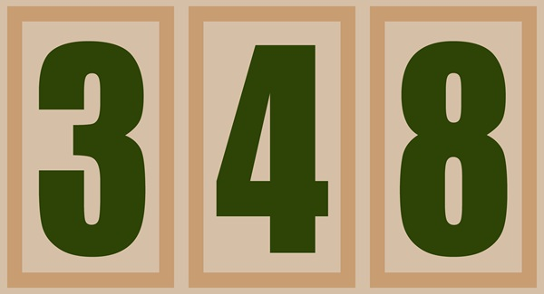

# BSA Unit Numbers

Computer generated versions of the [Boy Scouts of America](https://www.scouting.org/) Unit Number Patches.
- Cub Scouts (Packs): White embroidery on a red background
- Scouts BSA (Troops): Green embroidery on a khaki/tan background.
- Venturing: Can use either green-on-tan or white-on-red depending on the uniform shirt type.

